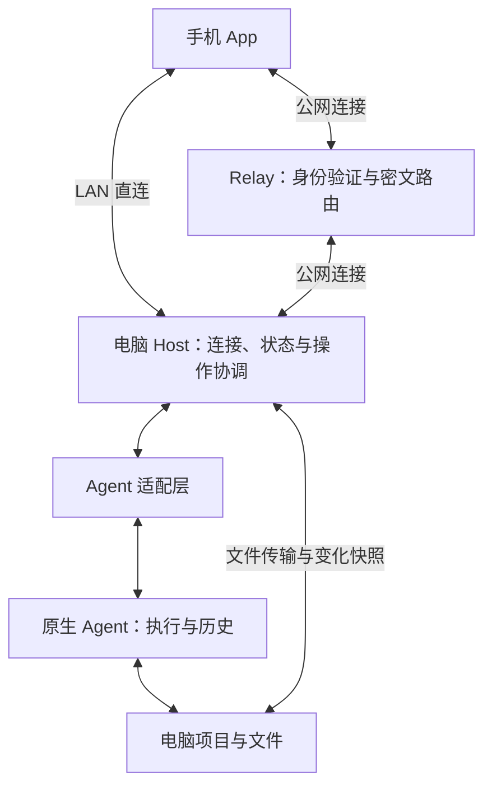
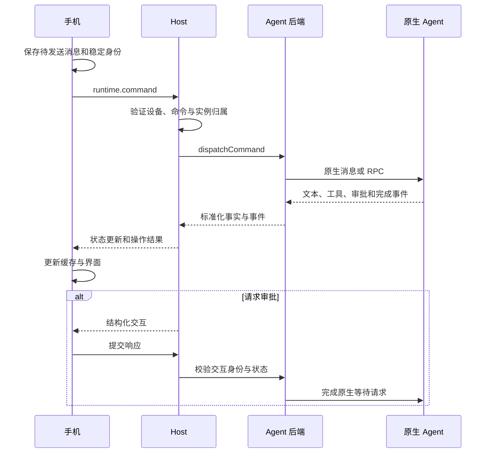
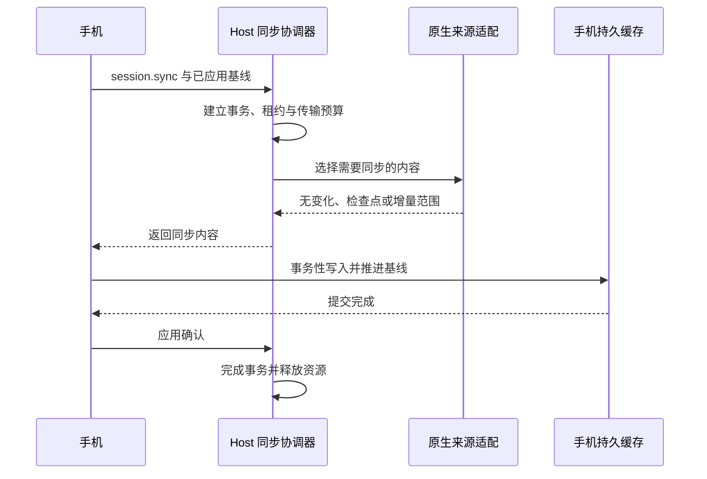

# Orbis 项目架构导读

> 阅读基线：2026-11-13，提交 `334f29ab89e739bbccad44416da410cfc76e3aa3`。 
> 本文依据当前源码与架构决策整理，描述代码中的架构；源码实现、自动验证、真机验收与实际部署分别判断。

## 1. 项目在做什么

**Orbis 将电脑上的编码 Agent 会话，转换成手机上可以操作的原生界面。**

电脑继续运行 Agent、工具和项目，并保存原始会话历史。Orbis Host 接入这些运行实例，将不同 Agent 的状态转换成统一模型，接收手机指令，再交给对应 Agent 执行。

系统分布在三个位置：

| 位置 | 组件 | 职责 |
| --- | --- | --- |
| 用户电脑 | Host、Agent 适配层、原生 Agent | 执行任务、读取历史、发布状态、提供文件 |
| 用户手机 | Android / iOS App | 展示会话、发送消息、处理审批、缓存历史、上传下载 |
| 中继服务器 | Relay | 身份验证、密文转发、注册与运维管理 |

整个项目最重要的分工是：

- **Agent 负责真实执行和原始历史。**
- **Host 负责标准化状态与远程操作协调。**
- **手机负责展示、输入、本地缓存和读取调度。**
- **Relay 负责转发加密消息。**

理解“接管原有开发环境”需要分 Agent 看。Pi 和 Claude 依赖扩展或插件接入进程；Codex 终端通过受管理的原生服务端连接官方 TUI；Codex Desktop 连接桌面应用自己的后端；DeepSeek 当前默认连接原生 Web 服务。是否加载桥接、经过受管理启动入口或提供可连接端点，决定了一个既有实例能否被接入。

## 2. 目录与技术栈

| 目录 | 技术 | 核心作用 |
| --- | --- | --- |
| `packages/host/` | TypeScript、Node.js | 电脑端业务核心 |
| `packages/protocol/` | TypeScript、Zod | 消息格式、状态模型、同步与传输契约 |
| `packages/e2e/` | TypeScript、Node crypto | 配对、握手、密钥与端到端加密 |
| `packages/runtime-bridge/` | TypeScript | 将运行时操作接入通用命令和事件模型 |
| `packages/pi-extension/` | TypeScript、Pi API | Pi 进程内扩展 |
| `packages/claude-mod/` | TypeScript、插件与脚本 | Claude Code 官方 TUI 桥接 |
| `packages/remote-interaction-sdk/` | TypeScript | 确认、选择、输入、问卷等结构化交互 |
| `packages/windows-host/` | C++20、Qt、QML | 桌面外壳；同一套源码也构建 macOS Host |
| `packages/relay/` | TypeScript、WebSocket | 中继、注册、控制台、官网与下载入口 |
| `android/` | Kotlin、Jetpack Compose | Android 原生客户端 |
| `ios/Orbis/` | Swift、SwiftUI | iOS 原生客户端 |
| `native/relayquic/` | Go、quic-go | 原生 QUIC 适配、Host helper、Android 绑定 |
| `scripts/` | Node、PowerShell、Python、Shell | 构建、打包、验证和性能测试 |
| `deploy/`、`.github/workflows/` | 部署配置、CI | 服务部署与客户端发布 |
| `CONTEXT.md`、`docs/adr/` | Markdown | 领域术语和架构决策 |

TypeScript 部分使用 npm workspaces 和 TypeScript project references 组织。Android、iOS、Qt 和 Go 各有自己的编译链。

**移动端主要共享协议与行为约定，并不直接复用 TypeScript 业务实现。** 因此修改协议时，通常需要同时考虑 TypeScript、Kotlin 和 Swift。

## 3. 理解架构前，先分清身份

| 名称 | 含义 | 使用场景 |
| --- | --- | --- |
| `hostId` | 一台电脑的稳定身份 | 多电脑隔离、配对和缓存归属 |
| `deviceId` | 一份手机安装的配对身份 | 授权、撤销、设备私有回执 |
| `agentKind` | Agent 接入类型 | 当前为 `pi / codex / codexDesktop / dsh / claude` |
| `sessionId` | 后端管理的会话身份 | 原生历史、恢复会话 |
| `runtimeId` | 当前在线实例的路由身份 | 将命令发送到正在运行的实例 |
| `commandId` | 一次命令身份 | 关联执行结果 |
| `syncId` | 一次同步事务身份 | 关联同步内容与应用确认 |
| `launchId` | 一次会话启动身份 | 中断恢复，避免重复创建 |

统一 Agent 会话身份是 `(hostId, agentKind, sessionId)`。

其中，`runtimeId` 可以随着实例替换而变化，不能拿它作为永久历史缓存身份。工作目录 `cwd` 用于项目分组和启动上下文；同一个目录可以运行多个会话，因此也不能用目录唯一标识会话。

关键定义：[agent-state.ts](../../packages/protocol/src/agent-state.ts)。

## 4. 电脑端：Qt 外壳与 TypeScript 核心

### 4.1 Qt 外壳

主要负责窗口、托盘、设置、安装更新入口、系统凭据存储，以及启动并管理 Node 后台进程。

| 文件 | 职责 |
| --- | --- |
| [main.cpp](../../packages/windows-host/src/main.cpp) | 原生应用入口 |
| [HostController.cpp](../../packages/windows-host/src/HostController.cpp) | 界面与后台之间的控制器 |
| [Main.qml](../../packages/windows-host/src/qml/Main.qml) | 主界面 |
| [desktop-bridge.ts](../../packages/host/src/desktop-bridge.ts) | Node 子进程通信入口 |
| [desktop-runtime.ts](../../packages/host/src/desktop-runtime.ts) | 桌面操作的业务编排 |

`HostController` 使用 `QProcess` 管理 Node 子进程，通过 stdin/stdout 交换带请求 ID 的 JSON 行消息。stdout 是协议管道，诊断信息通过事件或 stderr 输出。

修改配对、会话、Agent 接入或传输逻辑，应优先看 TypeScript Host；修改窗口、托盘或桌面布局，再看 Qt/QML。

### 4.2 Host 核心

[host-service.ts](../../packages/host/src/host-service.ts) 是系统的装配与协调中心。

| 职责 | 代表模块 |
| --- | --- |
| 配对和设备连接 | `pairing.ts`、`device-link.ts`、`device-session.ts` |
| 网络接入 | `lan-server.ts`、`relay-client.ts`、`loopback-server.ts` |
| Agent 接入 | `agent-backend.ts`、各 Agent runtime |
| 统一状态 | `agent-state-registry.ts`、`agent-state-facts.ts` |
| 状态订阅与发布 | `agent-state-subscriptions.ts`、`compact-state-model.ts` |
| 会话同步 | `session-sync-tasks.ts`、`history-delivery.ts` |
| 上传下载 | `artifact-download.ts`、`artifact-upload.ts` |
| 工具详情 | `tool-content-service.ts` |
| 文件变化 | `turn-change-coordinator.ts`、`turn-file-change-service.ts` |
| 供应商配置 | `provider-manager.ts` |
| 会话配置与启动恢复 | `session-configuration-store.ts` |

CLI 入口是 [cli.ts](../../packages/host/src/cli.ts)，提供 `host`、`pair`、`devices` 等命令。

CLI 与桌面应用复用核心服务，但桌面还承担首次激活、安装维护等流程，二者的产品能力不能直接画等号。

## 5. Agent 适配层

### 5.1 统一接口

[agent-backend.ts](../../packages/host/src/agent-backend.ts) 定义了 `AgentBackend`：

| 方法 | 含义 |
| --- | --- |
| `isReady()` | 后端是否就绪 |
| `catalog()` | 获取会话目录 |
| `activate()` | 新建或恢复会话 |
| `ownsRuntime()` | 判断在线实例归属 |
| `dispatchCommand()` | 执行已经路由到本后端的命令 |
| `directoryEntries()` | 提供在线实例信息 |
| 可选能力 | 工具详情、会话配置等 |

后端负责理解原生 Agent 语义；Host 负责身份验证、路由和通用协调。

运行实例不在线，与实例在线但后端不支持某条命令，需要返回不同结果，手机才能分别处理。

[runtime-bridge/src/index.ts](../../packages/runtime-bridge/src/index.ts) 中的 `RuntimePort` 更靠近实际运行时，定义发送消息、停止、Slash 和历史同步等操作。Pi 扩展将 Pi API 适配到这个端口，Host 的 PiBackend 再通过 loopback 与它连接。

### 5.2 各 Agent 如何接入原有环境

下表未写完整路径的 Host 文件，均位于 `packages/host/src/`。

| 后端 | 实际接入方式 | 核心代码 |
| --- | --- | --- |
| Pi | Pi 进程加载 Orbis 扩展，经本机 loopback 注册并交换命令、事件 | `pi-extension/src/index.ts`、`pi-adapter.ts`、Host 的 `spawner.ts` |
| Codex 终端 | Host 管理原生服务端，官方 TUI 通过 `--remote` 接入，手机操作同一份在线 thread | `codex-daemon.ts`、`codex-runtime.ts`、`codex-terminal-connection.ts` |
| Codex Desktop | 包装器发布桌面应用后端端点，Host 完成握手后连接 | `codex-desktop-wrapper.ts`、`codex-desktop-lifecycle.ts`、`codex-desktop-launcher.ts` |
| DeepSeek | 默认创建或复用经过认证的原生 Web 服务 | `dsh-runtime.ts`、`dsh-web-service.ts`、`dsh-web-client.ts`、`dsh-web-runtime.ts` |
| Claude Code | 官方插件内的 Mods 与 classic hooks 接入本机桥 | `claude-mod/src/register.ts`、Host 的 `claude-mods-bridge.ts`、`claude-hook-bridge.ts` |

这里有三个容易误解的地方：

1. **安装 Orbis 后，所有已经打开的终端并不会立即自动变得可控制。** 对应实例需要加载扩展、经过受管理启动入口，或者提供可连接端点。
2. **Codex 终端与 Codex Desktop 是独立后端。** 它们拥有不同的连接、命名空间和生命周期，不能另起一个终端服务端来代替桌面应用自己的运行状态。
3. **当前 DeepSeek 默认走 Web 后端。** `dsh-runtime.ts` 仍保留旧 ACP 实现供兼容调用，但 ACP 不是当前默认接入链路。

当前 Codex 终端实现会准备与所选 CLI 精确匹配的官方 `codex-app-server-package`，通过 `--session-source cli` 启动服务端；官方 CLI 继续承担 TUI。见 [codex-terminal-server.ts](../../packages/host/src/codex-terminal-server.ts)。

终端 shim 主要截获无参数交互式 `codex`；带参数调用及 Host 离线回退有独立处理。每个受管理终端使用独立连接，通过关联的原生响应确定其当前 thread，不能凭全局广播或相同目录推断归属。

## 6. 手机发送消息的完整流程

下图省略加密与中继细节，展示业务控制流。

应分别理解以下阶段：

1. 手机把消息写入网络。
2. Host 接受命令。
3. 原生 Agent 接受输入。
4. Agent 执行任务。
5. 消息进入原生历史。

发送动画结束，只能说明其中某个阶段完成，不能自动等同于任务执行成功。

审批、选择和问卷属于结构化交互。后端必须确认响应对应哪次原生请求，并保证有效结果只接受一次。支持本地与手机竞答的链路，还需要正确结束另一侧的等待。

另外，**修改会话权限设置，与回答一次工具审批，是两个不同操作。**

## 7. 新建会话与配置确认

新建会话除了启动进程，还涉及模型、思考深度、权限和首句发送。

当前实现通过 [session-configuration-store.ts](../../packages/host/src/session-configuration-store.ts) 保存启动状态：

1. 手机保留草稿、首句与稳定 `launchId`。
2. Host 在实际启动前记录配置、版本和参数指纹。
3. 后端直接带配置创建，或者先创建空会话再应用配置。
4. Host 核对原生配置，记录准确会话身份。
5. 配置确认后，首句进入正常发送链路。

**运行实例上线，不等于本次配置已经生效。** 这道边界避免用户选择了某个模型，但首句抢先交给默认模型执行。

断线后，应查询原启动操作的结果，而不是直接再次创建会话。

协议定义了 `auto / tui / headless`，但实际支持取决于平台和后端。当前手机常规入口默认请求 TUI，不能因为存在 `headless` 字段就认定无桌面运行已经完整交付。

## 8. 状态同步是项目复杂度的核心

### 8.1 三层状态归属

| 层次 | 负责人 | 内容 |
| --- | --- | --- |
| 原生事实 | Agent | 原始历史、真实执行状态、工具和权限语义 |
| 统一事实 | Host 与后端适配 | 标准化状态、显示投影、能力和通知 |
| 本地事实 | 手机 | 配对、选中电脑、草稿、outbox、缓存、阅读位置 |

Host 将不同原生格式转换为统一投影，手机按通用模型展示。手机仍负责本地缓存、状态应用和读取调度，因此它也有较多业务代码。

### 8.2 统一状态 Registry

核心文件：

- [agent-state.ts](../../packages/protocol/src/agent-state.ts)：统一契约。
- [agent-state-registry.ts](../../packages/host/src/agent-state-registry.ts)：标准状态的校验与持有。
- [agent-state-facts.ts](../../packages/host/src/agent-state-facts.ts)：将后端事实接入统一状态。
- [agent-state-subscriptions.ts](../../packages/host/src/agent-state-subscriptions.ts)：按订阅发布。

一个状态领域不仅有“值”，还包含模型与来源版本、可用性、完整性和最近核对时间。这样才能区分“已确认没有工具在执行”“工具状态尚未读取”“原生来源当前不可用”。

Agent 共享事实与设备私有视图分开。某台手机的操作回执、通知关闭记录、文件任务，不应直接当作所有设备共享的 Agent 状态。

### 8.3 实时内容与历史需要对账

正在流式生成的回复、正在执行的工具，与已经写入原生历史的 Entry，处于不同生命周期。原生落盘后，需要让实时内容正确转入历史，避免重复显示。

历史使用稳定 Entry ID 和 parent 关系组织。某个分支是从 leaf 沿 parent 读取的结果，不需要为每一页、每个分支复制整份聊天记录。

### 8.4 同步有明确的应用确认

最关键的区别：

- `sent`：Host 已完成传输写出。
- `applied`：手机已将内容提交到缓存，并推进应用基线。

Host 不能因为内容已经写入 socket，就认为手机已经保存。同步有事务身份、租约和交付预算；确定失败或租约到期需要结束事务并释放资源。

Android 的 [SessionGraphStore.kt](../../android/app/src/main/java/com/orbising/orbis/SessionGraphStore.kt) 和 iOS 的 [SessionHistoryStorage.swift](../../ios/Orbis/Orbis/SessionHistoryStorage.swift) 都使用 SQLite 管理历史缓存。原始历史仍归 Agent，手机缓存需要能够按来源版本核对和恢复。

## 9. 网络与加密

### 9.1 LAN / Relay 是业务路径选择

[path.ts](../../packages/host/src/path.ts) 的规则很明确：**已经握手成功的 LAN 优先，Relay 兜底。** RTT 用于展示，不参与动态排序。

同一手机可以同时拥有 LAN 和 Relay 路径，每条路径维护独立的加密会话。握手响应原路返回，主动推送走当前生效路径。

本机 loopback 服务于电脑内部 Agent 桥接，通过发现文件和本地 token 接入，与面向手机的 LAN 入口有不同的暴露边界。

### 9.2 WS / QUIC 是 Relay 承载选择

这是另一个维度：

| 选择 | 回答的问题 |
| --- | --- |
| LAN / Relay | 业务消息经过哪里 |
| WS / QUIC | 中继连接使用什么底层传输 |

当前 `auto` 实际使用 WebSocket。显式 QUIC 需要服务端和客户端具备对应支持。

Host 到 Relay、手机到 Relay 可以分别选择承载。Go QUIC 适配进程将流量接入同机 Node Relay 的固定入口；Android 使用 Go 绑定，iOS 使用系统 Network.framework。

传输包含 `ctl / msg / bulk` 等逻辑通道，并可协商 `history / catchup`，用于隔离控制、历史和大文件的发送预算。

WebSocket 的这些通道最终仍共用有序连接，所以还需要应用层队列、水位和背压。仅增加 channel 字段不能消除排队。实现见 [outbound-mux.ts](../../packages/protocol/src/outbound-mux.ts)。

### 9.3 激活、配对和握手是三件事

| 操作 | 目的 |
| --- | --- |
| Host 激活 | 让电脑取得 Relay 接入凭据，验证要求由服务器策略决定 |
| 手机配对 | 通过短时单次二维码建立设备信任关系 |
| 路径握手 | 为当前连接建立临时会话密钥 |

加密模块使用 X25519、HKDF-SHA256 和 AES-256-GCM，相关实现位于 `packages/e2e/`，移动端按同一契约实现。

Relay 能看到路由头、连接关系和流量元数据，但无法解密会话与文件业务内容。

当前内部协议版本为 19。Host 和 Relay 在各自边界处理已实现的兼容逻辑，Relay 不解密或改写 E2E 业务消息。

Relay 主入口为 [main.ts](../../packages/relay/src/main.ts) 与 [index.ts](../../packages/relay/src/index.ts)。它还装配注册、管理、推送和 Web 服务，但不解释原生 Agent 对话。

## 10. 文件与工具大内容

聊天同步中不会默认塞入所有大内容。

| 数据 | 默认同步什么 | 详情如何读取 |
| --- | --- | --- |
| 工具执行 | 身份、阶段、顺序和内容引用 | 按 UTF-8 范围读取，核对版本与租约 |
| 文件变化 | 文件与变化摘要 | Host 保留轮次比较依据，按文件、分页读取 diff |
| 图片 | 类型、大小、路径或 artifact 引用 | 走文件下载链路 |
| 普通文件 | 路径与传输元数据 | 分片传输与断点恢复 |

核心文件：

- [tool-content-service.ts](../../packages/host/src/tool-content-service.ts)
- [turn-file-change-service.ts](../../packages/host/src/turn-file-change-service.ts)
- [artifact-download.ts](../../packages/host/src/artifact-download.ts)
- [artifact-upload.ts](../../packages/host/src/artifact-upload.ts)

工具原始参数和输出不进入共享摘要模型；详情读取属于设备私有操作。内容过期、版本不一致或不存在，需要返回明确结果。

下载由手机拉取指定 offset 的范围。**手机已经写入临时文件的连续前缀，是下载进度的依据。** Host 主要负责响应范围请求。

上传时则以 **Host 已经持久接收的连续前缀** 为恢复依据。“发出分片”“收到分片”和“数据落盘”需要分别处理。

## 11. 手机端结构

| 职责 | Android | iOS |
| --- | --- | --- |
| 界面入口 | `MainActivity.kt`、`RemoteUi.kt` | `OrbisApp.swift`、`ContentView.swift` |
| 多电脑聚合 | `RemoteViewModel.kt` | `OrbisHub.swift` 中的 `OrbisStore` |
| 单台电脑连接 | `HostConnection.kt` | `OrbisStore.swift` 中的 `HostConnection` |
| 状态镜像 | `AgentModelState.kt`、`RemoteState.kt` 等 | `AgentState.swift`、`HostState.swift` |
| 历史缓存 | `SessionGraphStore.kt` | `SessionHistoryStorage.swift` |
| 操作与待发送消息 | `OperationLedger.kt`、`PendingSends.kt` | 对应 Swift 模块 |
| 文件与工具内容 | `PullScheduler.kt`、`ToolContent.kt` 等 | `FileTransfers.swift`、`ToolContent.swift` 等 |

Android 代码主要位于 `android/app/src/main/java/com/orbising/orbis/`，iOS 代码主要位于 `ios/Orbis/Orbis/`。

每台已配对电脑维护独立连接和状态。切换当前电脑，主要是切换交互对象；其他电脑的连接可以继续存在。同一电脑重新配对，应替换旧记录，避免重复连接。

需要注意：iOS 的文件名与类名并非一一对应，阅读时应按符号追踪。

## 12. 启动、停止和开发入口

桌面启动链路为：Qt 启动 Node bridge，DesktopRuntime 加载设置和安装状态，创建 HostService，再建立本机入口、网络连接以及需要的后端。

Host 启动会先检查 LAN 监听，避免同一身份的重复 Host 竞争 Relay 和本机发现文件；随后初始化文件变化、临时内容、loopback 和后端接入。

关闭窗口通常进入托盘；暂停 Host、确认退出 Host、关闭一个 Agent 会话具有不同含义。受管理进程、外部 Web 服务、独立终端及桌面应用需要按资源归属处理。相关逻辑见 [desktop-shutdown.ts](../../packages/host/src/desktop-shutdown.ts)。

| 工作 | 入口 |
| --- | --- |
| TypeScript 构建 | `npm run build` |
| 静态类型与测试 | `npm run typecheck`、`npm test` |
| 代码规范 | `npm run lint` |
| Windows Host 打包 | `scripts/windows/windows-host-build.ps1` |
| Android 构建 | `scripts/windows/android-build.ps1` 及 Android 构建配置 |
| iOS 验证 | `scripts/check-ios.sh`、Xcode 工程 |
| Go 传输测试 | 在 `native/relayquic/` 下执行对应 Go 测试 |
| Relay 部署 | `.github/workflows/relay-deploy.yml`、`docs/deployment.md` |

TypeScript 构建成功，不代表 Qt、Android、iOS 和 QUIC 组件均已构建；单元测试通过，也不能替代原生 Agent、真实审批和手机网络切换的验证。

## 13. 如何阅读和修改这个项目

### 13.1 推荐阅读顺序

1. [CONTEXT.md](../../CONTEXT.md)：理解 Host、Session、Runtime、Path 等术语。
2. [agent-state.ts](../../packages/protocol/src/agent-state.ts)：理解身份和统一状态模型。
3. [agent-backend.ts](../../packages/host/src/agent-backend.ts)：理解后端边界。
4. [host-service.ts](../../packages/host/src/host-service.ts)：看服务装配、入口和分派，先跳过细节。
5. 选择一个后端，追踪完整消息链；[Pi 适配器](../../packages/pi-extension/src/pi-adapter.ts) 和 [Pi 扩展入口](../../packages/pi-extension/src/index.ts) 相对适合作为起点。
6. 再看同步、缓存和网络切换。

### 13.2 按改动目标找入口

下表中的简写文件名应结合第 2 节目录地图定位；未注明的 Host 模块位于 `packages/host/src/`。

| 目标 | 优先阅读 |
| --- | --- |
| 接入原有开发环境 | Pi 扩展、Claude 插件、`codex-shim.ts`、`codex-terminal-connection.ts` |
| 新增 Agent | `AgentBackend`、`RuntimePort`、AgentKind、状态投影和能力发布 |
| 调整聊天同步 | 协议包的 `session-source.ts`、`session-sync.ts`，Host 的 `session-sync-tasks.ts` |
| 修改手机界面 | 先找状态投影，再改 Compose / SwiftUI 页面 |
| 排查连接问题 | `device-link.ts`、`device-session.ts`、`path.ts`、`relay-client.ts` |
| 排查 Codex 串会话或误关闭 | `codex-terminal-connection.ts`、`codex-runtime.ts` 与平台窗口归属逻辑 |
| 优化工具输出或内存 | `tool-content-service.ts`、协议包的 `outbound-mux.ts` |
| 修改供应商和模型配置 | `provider-manager.ts`、各 provider 适配、`session-configuration-store.ts` |
| 修改桌面功能 | `HostController.cpp`、`desktop-bridge.ts`、`desktop-runtime.ts` |
| 自建中继 | Relay 入口、`docs/deployment.md`、`docs/native-quic.md` |

## 14. 架构评价与当前边界

**项目的主要复杂度来自：在多种原生 Agent、多设备、实时执行和断线恢复之间，维持可信的一致状态。**

已有设计中比较有价值的部分：

- 原生执行和历史归属明确。
- 不同 Agent 的语义解释集中在后端。
- 手机消费统一模型。
- 工具详情与文件内容按需读取。
- 同步、文件和控制具备独立预算与恢复机制。

继续开发需要重点关注：

| 关注点 | 实际影响 |
| --- | --- |
| `HostService` 协调职责较多 | 新功能应优先放入领域服务，避免继续堆积特殊分支 |
| 原生 Agent API 与启动方式变化 | 需要验证真实启动、执行、审批、历史和退出 |
| 跨端协议有多份实现 | 修改 TypeScript 类型后，还需检查 Kotlin、Swift 与旧端兼容 |
| 在线身份与历史身份不同 | 路由、缓存、关闭操作都必须保留准确归属 |
| ADR 包含旧修订和提案 | 判断当前能力时，需要对照当前调用链与后续修订 |

当前应明确保留的能力边界：

- **DSH Desktop 尚未实现、未部署**，当前默认接入是 Web，见 [ADR-0076](../adr/0076-deepseek-harness-desktop-integration.md)。
- 通用 CLI 无头产品与 Linux 桌面支持仍有提案和验证缺口，见 [ADR-0077](../adr/0077-cli-host-and-headless-validation.md) 与 [ADR-0078](../adr/0078-linux-desktop-host.md)。
- QUIC 已有实现，自动模式当前仍选择 WS；性能与设备验收需要单独看证据。
- 统一能力模型不代表每个 Agent 都支持全部操作，应以实际发布和确认的能力为准。
- 源码实现、自动测试、真机验收和实际部署是不同状态。

继续深入可优先阅读：ADR-0021 / 0022（Codex 两种入口）、ADR-0025 / 0026（原生历史与同步）、ADR-0032（统一状态）、ADR-0033（Claude）、ADR-0045（工具内容）、ADR-0065（QUIC）和 ADR-0072（可恢复启动）。

本文基于源码阅读整理，未执行构建或运行验证。
